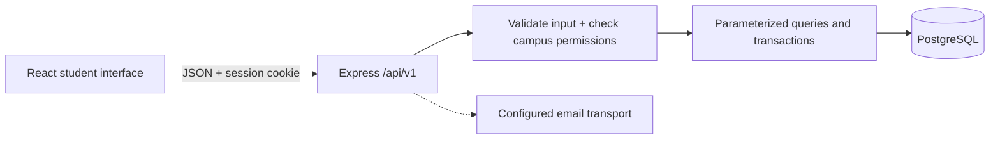

# UniBoard

A digital campus noticeboard where students discover opportunities, find people, and organize activities within their university.

This is a learning project with a working React interface, an Express/PostgreSQL API, explicit permission rules, and documentation that explains the code. The design is intentionally restrained. The main investment is in readable boundaries, data integrity, and a repeatable development workflow.

## Stack

| Part           | Technology                                                                    | Why it is here                                                                     |
| -------------- | ----------------------------------------------------------------------------- | ---------------------------------------------------------------------------------- |
| Interface      | React 19, TypeScript, React Router, Vite                                      | Components, typed browser code, navigation, and fast development builds.           |
| Styling        | Tailwind CSS v4 plus small CSS files and design tokens                        | A consistent minimal visual system without a large component framework.            |
| Server         | Node.js 24, Express 5, TypeScript                                             | An explicit, approachable HTTP API.                                                |
| Database       | PostgreSQL with `pg` and versioned SQL migrations                             | Relationships, transactions, ownership, and campus constraints are visible in SQL. |
| Validation     | Zod                                                                           | Validate data at runtime, including different fields for each post type.           |
| Authentication | Opaque database sessions in HttpOnly cookies; salted `scrypt` password hashes | Revocable sessions and server-controlled identity.                                 |
| Verification   | Node test runner, Supertest, real PostgreSQL integration tests                | Check authorization, HTTP behavior, and actual database constraints.               |
| Workflow       | npm workspaces, Prettier, GitHub Actions                                      | One install/lockfile, consistent formatting, and repeatable checks.                |

## Run the browser demo

Install **Node.js 24** with npm **11 or newer**, then run these commands from this directory:

```powershell
npm ci
npm run dev:web
```

Open [the local application](http://127.0.0.1:5173). No database or account is required in demo mode.

The default demo has sample campus posts and a browser-local student profile. You can search/filter, create and preview posts, save drafts, edit your own posts, comment/reply, bookmark posts, explore clubs, and try the reporting workflow. Demo changes stay in this browser. The interface identifies this mode, and preview sign-in does not collect a password or send email.

## Run the shared application

API mode uses real account sessions and PostgreSQL. You need an existing local PostgreSQL database or a development cloud database; the example connection string does not create one.

```powershell
Copy-Item server/.env.example server/.env
Copy-Item campus/.env.example campus/.env
```

Edit `server/.env` with your database connection and keep `NODE_ENV=development` while learning locally. Edit `campus/.env`:

```dotenv
VITE_DATA_MODE=api
```

Then run:

```powershell
npm run db:migrate
npm run db:seed
npm run dev
```

The frontend runs at `http://127.0.0.1:5173` and proxies `/api` to the API at `http://127.0.0.1:3001`. Use that exact frontend origin; `localhost` and `127.0.0.1` are different browser origins. Restart Vite after changing its environment setting.

The optional **development-only** seed creates these accounts:

| Account   | Email                               | Password                   |
| --------- | ----------------------------------- | -------------------------- |
| Student   | `elira.hoxha@student.unitir.edu.al` | `UniBoard-Student-2026!`   |
| Moderator | `moderator@unitir.edu.al`           | `UniBoard-Moderator-2026!` |

The seed refuses to run outside explicit development mode. Do not use these credentials or seed records in a real deployment. Re-running it preserves existing account passwords.

For a new account, register and verify its email before signing in. A development API returns a one-time `developmentToken` that the account dialog can use to exercise verification/reset without email delivery. Production never returns that shortcut and requires a configured email transport. After signing in, choose a university and request membership using a recognized university email or manual review evidence.

## Architecture

One repository contains two applications, deployed together as a **modular monolith**. The browser renders the interface; the server decides who can do what; the database preserves shared records and their relationships.



```text
UniBoard/
├── campus/                     React application
│   ├── src/
│   │   ├── main.tsx            Mount React
│   │   ├── App.tsx             Compose navigation, screens, and dialogs
│   │   ├── components/         Cards, shell, account/post/report dialogs
│   │   ├── pages/              Feed, dashboard collections, clubs, moderation
│   │   ├── features/board/     Demo/API state adapters and feed selectors
│   │   ├── lib/                API transport, DTO mapping, guarded storage
│   │   ├── types.ts            Frontend data shapes
│   │   ├── data.ts             Clearly separated sample content
│   │   └── styles.css          Tailwind entry, tokens, shared styles
│   └── vite.config.ts          React/Tailwind plugins and development proxy
├── server/
│   ├── src/
│   │   ├── index.ts            Parse configuration, start/stop the process
│   │   ├── app.ts              Configure middleware and mount routers
│   │   ├── routes/             Account and university HTTP endpoints
│   │   ├── http.ts             Errors and authentication/membership guards
│   │   ├── validation.ts       Strict runtime request schemas
│   │   ├── security.ts         Passwords, random tokens, cookie options
│   │   ├── db.ts               PostgreSQL pool and transaction helper
│   │   └── scripts/            Explicit migration and development seed commands
│   ├── migrations/             Versioned schema, constraints, and indexes
│   └── test/                   Security and real database integration tests
├── docs/                       Explanations, API examples, and roadmap
├── .github/workflows/ci.yml     Build and test with a PostgreSQL service
├── render.yaml                 Same-origin Render deployment blueprint
└── package.json                Workspaces and common commands
```

The [architecture guide](docs/architecture.md) explains each folder, request flow, database relationships, and the reasons behind the decisions. Closely related API logic starts in two feature routers. Extract a service/repository when a workflow warrants it; avoid empty layers that only forward function calls.

## What works and what comes next

API mode connects account registration/login/logout, token-based verification/reset, membership requests, profiles, campus posts and all nine post types, comments/replies, saved posts, polls, notifications, reports, and campus moderation. Ownership and campus/faculty visibility are enforced on the server. Report decisions and content removal create audit records and notifications.

Current limits are explicit:

- The UI loads the newest 100 feed posts plus saved posts and filters that loaded set. The API already supports paginated search; a full archive/search interface remains a next step.
- Drafts remain local to the browser. Images use URLs; durable attachment/image uploads need object storage.
- Email delivery uses a configurable HTTPS webhook contract. You must connect an actual provider for production; it is not an included mail service.
- Club reference pages are available; club-officer publishing, organization management, and full university/platform administration are future modules.
- Likes and accepted answers are demo-only and are hidden in API mode.
- The application has passed builds and automated API/database checks. Complete browser acceptance testing and production email verification are still release tasks.

See the [MVP acceptance criteria and roadmap](docs/product-roadmap.md) for the full scope and remaining work.

## Commands and documentation

```powershell
npm run check        # TypeScript checks
npm test             # Workspace tests; database suite needs TEST_DATABASE_URL
npm run build        # Build React and compile Express
npm run format       # Format source and documentation
npm run format:check # Verify formatting without changing files
```

The database integration suite creates a randomly named schema and drops that schema afterward. Set `TEST_DATABASE_URL` only to a disposable development/test database, never your production database. GitHub Actions supplies its own PostgreSQL service.

Validation on October 15, 2026: both application builds and formatting passed; all 36 tests passed with no skips (19 frontend/API contract tests and 17 server tests), using a disposable PostgreSQL 18 database. Browser checks covered the demo post editor and preview, search, club navigation, and the narrow-window layout. A hosting smoke check verified React assets, direct client routes, and API health through Express. Complete multi-account browser acceptance testing and production email delivery remain release checks.

| Read                                                  | What you will learn                                                                                         |
| ----------------------------------------------------- | ----------------------------------------------------------------------------------------------------------- |
| [Architecture and folder guide](docs/architecture.md) | Responsibilities, diagrams, database relationships, boundaries, and tradeoffs.                              |
| [Development guide](docs/development.md)              | Setup, environment variables, scripts, conventions, testing, and how to add a feature.                      |
| [API guide](docs/api.md)                              | Executable account-to-post examples, request/response shapes, post types, errors, and moderation endpoints. |
| [Deployment guide](docs/deployment.md)                | Render + Neon, same-origin cookies, migrations, email transport, health checks, and recovery.               |
| [Product roadmap](docs/product-roadmap.md)            | Roles, MVP acceptance criteria, current limits, and sensible delivery phases.                               |

## Free hosting recommendation

Use one **Render Node web service** to serve the built React app and Express API, and **Neon PostgreSQL** for the database. The included blueprint and deployment guide show the configuration; infrastructure has not been provisioned or published.

Verified October 15, 2026: Render's free web service sleeps after 15 idle minutes and has an ephemeral filesystem, so uploaded files cannot live on its local disk. Its free PostgreSQL offering expires after 30 days. Neon provides a free PostgreSQL plan; check the current quotas before deployment. Free services are appropriate for learning and small demonstrations, with cold starts and usage limits. [Render free service documentation](https://render.com/docs/free) · [Neon pricing](https://neon.com/pricing) · [Tailwind Vite integration](https://tailwindcss.com/docs/installation/using-vite)
