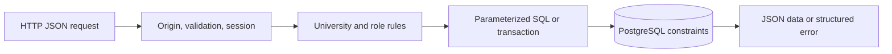

# API guide and runnable examples

The Express API uses `/api/v1`, JSON request bodies, and a server-managed session cookie. This guide follows the implemented [account routes](../server/src/routes/auth.ts), [campus routes](../server/src/routes/campus.ts), [validation schemas](../server/src/validation.ts), and [SQL migration](../server/migrations/001_initial.sql). Those sources remain the definitive contract.

The examples use PowerShell's `Invoke-RestMethod`, which parses JSON responses into objects. Run the sections in order in the same PowerShell terminal. They target a **private development database** and an API running with `NODE_ENV=development`; do not run account-creation or moderation examples against production.

## Before the examples

Follow [development setup](./development.md): configure `server/.env`, run `npm run db:migrate`, run the development-only `npm run db:seed`, then start `npm run dev:api`. The examples assume port 3001 and the seeded University of Tirana.

The development server can return `developmentToken` when no real email provider is configured. That value comes from the API response; the client must never invent one. Test/production environments do not expose this shortcut. Real production verification/reset requires email delivery.

```powershell
$base = "http://127.0.0.1:3001/api/v1"
$json = "application/json"
$suffix = [Guid]::NewGuid().ToString("N").Substring(0, 8)
$emailAddress = "api-learner-$suffix@student.unitir.edu.al"
$password = "Local-API-Practice-2026!" # Public example for a disposable development account only.
Invoke-RestMethod "$base/health"
Invoke-RestMethod "$base/health/ready"
```

The process health route reports configuration. The readiness route checks database connectivity. Neither replaces exercising the schema-dependent flow below.

## 1. Register and verify the account

```powershell
$registrationBody = @{ name = "API Learner"; email = $emailAddress; password = $password }
$registered = Invoke-RestMethod "$base/auth/register" -Method Post -ContentType $json -Body ($registrationBody | ConvertTo-Json)
$registered.data | Select-Object id, email, email_verified

if (-not $registered.developmentToken) {
  throw "No development token was returned. Use the real delivered verification token, or run a private development API."
}
$verificationBody = @{ token = $registered.developmentToken }
Invoke-RestMethod "$base/auth/verify-email" -Method Post -ContentType $json -Body ($verificationBody | ConvertTo-Json)
```

Registration returns `201`. The account initially has `email_verified: false`; consuming the token returns:

```json
{ "data": { "verified": true } }
```

The token expires and can be consumed once. Trying it a second time returns `400 INVALID_TOKEN`. Registration does not automatically sign the user in.

## 2. Sign in and retain the cookie

```powershell
$loginBody = @{ email = $emailAddress; password = $password }
$signedIn = Invoke-RestMethod "$base/auth/login" -Method Post -ContentType $json -Body ($loginBody | ConvertTo-Json) -SessionVariable campusSession
Invoke-RestMethod "$base/auth/me" -WebSession $campusSession
```

`-SessionVariable campusSession` creates a PowerShell web session containing the response cookie. Subsequent `-WebSession $campusSession` calls send it. Do not extract this cookie into a URL or browser localStorage. In production, it is Secure, HttpOnly, and SameSite=Lax.

Login checks the current password while holding the account row lock, so a concurrent completed password reset cannot be followed by session creation using the old password. Resetting a password invalidates existing sessions.

## 3. Find the university/faculty and join

```powershell
$universities = Invoke-RestMethod "$base/universities"
$university = $universities.data | Where-Object slug -eq "university-of-tirana" | Select-Object -First 1
if (-not $university) { throw "Run the development seed or select a real university from the response." }
$universityId = $university.id
$faculties = Invoke-RestMethod "$base/universities/$universityId/faculties"
$faculty = $faculties.data | Where-Object name -eq "Natural Sciences" | Select-Object -First 1
if (-not $faculty) { throw "Select a faculty belonging to this university." }
$campus = "$base/universities/$universityId"

$membershipBody = @{ facultyId = $faculty.id }
$membership = Invoke-RestMethod "$campus/membership" -Method Post -ContentType $json -Body ($membershipBody | ConvertTo-Json) -WebSession $campusSession
$membership.data | Select-Object university_id, faculty_id, status, role
```

This specific example has already verified its account email on the university's configured domain, so the membership can be approved immediately. A different university email needs its own token; a personal-email account needs manual evidence/review. The server decides the status. A client-supplied role or approval flag is not accepted.

Faculty UUIDs must belong to the chosen university. The database has a composite foreign key for that relationship, so using a faculty from another university fails even if a future route forgets the check.

## 4. Publish and read a Question post

```powershell
$postBody = @{
  type = "Question"
  title = "Where can we practice SQL together?"
  body = "Looking for a quiet study space and a few people to prepare for databases."
  facultyId = $null
  tags = @("databases", "study-together")
  details = @{ topic = "Study spaces" }
  status = "open"
}
$post = Invoke-RestMethod "$campus/posts" -Method Post -ContentType $json -Body ($postBody | ConvertTo-Json -Depth 6) -WebSession $campusSession
$postId = $post.data.id
Invoke-RestMethod "$campus/posts/$postId" -WebSession $campusSession
Invoke-RestMethod "$campus/posts?type=Question&tag=databases&page=1&limit=20" -WebSession $campusSession
```

`facultyId: null` means university-wide. A regular student can instead target their own faculty. Creation returns `201` with the stored post in `data`; reading a detail also joins display information such as `author_name`, `author_avatar`, `faculty_name`, and `comment_count`.

Inputs use camelCase names such as `facultyId` and `imageUrl`. Stored response fields normally use SQL names such as `faculty_id`, `image_url`, and `created_at`. The frontend mapper handles this translation.

A feed response has this shape, with each post abridged here for readability:

```json
{
  "data": [
    {
      "id": "<post-uuid>",
      "university_id": "<university-uuid>",
      "author_id": "<user-uuid>",
      "type": "Question",
      "title": "Where can we practice SQL together?",
      "faculty_id": null,
      "details": { "topic": "Study spaces" },
      "status": "open"
    }
  ],
  "meta": { "page": 1, "limit": 20, "total": 1 }
}
```

To edit, send the **complete validated post payload** with `PUT /universities/:universityId/posts/:postId`. To remove your post, use `DELETE` on that same path. An author cannot edit someone else's post; moderation removal uses a separate endpoint.

## 5. Comment, reply, and close comments

```powershell
$commentBody = @{ body = "I can bring practice exercises." }
$comment = Invoke-RestMethod "$campus/posts/$postId/comments" -Method Post -ContentType $json -Body ($commentBody | ConvertTo-Json) -WebSession $campusSession
$commentId = $comment.data.id

$replyBody = @{ body = "A follow-up on the same thread."; parentId = $commentId }
Invoke-RestMethod "$campus/posts/$postId/comments" -Method Post -ContentType $json -Body ($replyBody | ConvertTo-Json) -WebSession $campusSession
Invoke-RestMethod "$campus/posts/$postId/comments?page=1&limit=20" -WebSession $campusSession

$closedBody = @{ closed = $true }
Invoke-RestMethod "$campus/posts/$postId/comments-status" -Method Patch -ContentType $json -Body ($closedBody | ConvertTo-Json) -WebSession $campusSession
```

The post author can close comments. New comments/replies then return `409 COMMENTS_CLOSED`. Reopen using `{ "closed": false }`. A reply's parent must be an existing, nonremoved comment on the same post and university.

Edit your own comment with `PATCH /universities/:universityId/comments/:commentId` and `{ "body": "Revised text" }`. Delete it with `DELETE` on that path. Removed comments retain a thread placeholder rather than exposing the removed body.

## 6. Save the post and read notifications

```powershell
Invoke-RestMethod "$campus/bookmarks/$postId" -Method Put -WebSession $campusSession
$saved = Invoke-RestMethod "$campus/bookmarks?page=1&limit=20" -WebSession $campusSession
$saved.data | Select-Object id, title

$notifications = Invoke-RestMethod "$base/notifications?page=1&limit=20" -WebSession $campusSession
$notifications.data | Select-Object id, title, body, read_at
if ($notifications.data.Count -gt 0) {
  $notificationId = $notifications.data[0].id
  Invoke-RestMethod "$base/notifications/$notificationId" -Method Patch -ContentType $json -Body '{"read":true}' -WebSession $campusSession
}
```

Saving the same post again is safe; it does not duplicate a bookmark. Unsave with `DELETE /universities/:universityId/bookmarks/:postId`.

The comments above are your own, so they do not create self-notifications. A second student's comment/reply produces the relevant notification for the author or parent-comment author. Moderation/membership decisions also produce notifications. Account-level `/notifications` remains available to suspended/rejected members so they can read decisions; campus-scoped notification routes require approved membership.

## Other account operations

| Route                            | JSON body or behavior                                                                                                                                                                                                                |
| -------------------------------- | ------------------------------------------------------------------------------------------------------------------------------------------------------------------------------------------------------------------------------------ |
| `GET /auth/me`                   | Current account and memberships; session required.                                                                                                                                                                                   |
| `POST /auth/logout`              | No body required; invalidates the presented session and returns `204`.                                                                                                                                                               |
| `POST /auth/resend-verification` | `{ "email": "student@example.com" }`.                                                                                                                                                                                                |
| `POST /auth/forgot-password`     | `{ "email": "student@example.com" }`; uses a generic eligibility message.                                                                                                                                                            |
| `POST /auth/reset-password`      | `{ "token": "the-delivered-token", "password": "a-new-password-at-least-12-characters" }`.                                                                                                                                           |
| `GET /profile`                   | Current profile; session required.                                                                                                                                                                                                   |
| `PATCH /profile`                 | Full profile form: required `name`; `program`, `bio`; optional nullable `avatarUrl` and `year`. Omitted optional/default fields are cleared/defaulted, so send the complete form. Account email and membership/faculty are separate. |

One-time tokens expire after 30 minutes. Passwords have a minimum of 12 and maximum of 128 characters. A reset token is purpose-bound and cannot be used as an email or membership verification token. Tokens and cookies in these examples are runtime values; never commit captured real values. The current API-mode account dialog accepts tokens manually; automatic verification/reset deep links remain a separate improvement.

## Membership verification and manual review

There are three supported paths:

| Path                                                          | Request/result                                                                                                                     |
| ------------------------------------------------------------- | ---------------------------------------------------------------------------------------------------------------------------------- |
| Verified account email matches a configured university domain | `POST .../membership` with `facultyId`; server can approve immediately.                                                            |
| A separate university email                                   | Include `universityEmail` with `facultyId`; pending membership plus delivered token. Submit token to `POST .../membership/verify`. |
| No university email                                           | Include a meaningful `evidence` explanation with `facultyId`; pending membership for moderator review.                             |

For a separate university email, the request body is:

```json
{ "facultyId": "<faculty-uuid>", "universityEmail": "student@student.unitir.edu.al" }
```

After receiving that request's actual token, the verification body is `{ "token": "<delivered-membership-token>" }` at `POST /universities/:universityId/membership/verify`, using the same signed-in student's session. In explicit development mode, that token can come from the returned `developmentToken`. An approved/suspended membership cannot be overwritten by making another request.

To exercise manual review, use a fresh verified personal-email account. This block continues with `$base`, `$json`, `$suffix`, `$password`, `$faculty`, and `$campus` from the earlier examples:

```powershell
$manualEmail = "manual-learner-$suffix@example.com"
$manualBody = @{ name = "Manual Membership Learner"; email = $manualEmail; password = $password }
$manualAccount = Invoke-RestMethod "$base/auth/register" -Method Post -ContentType $json -Body ($manualBody | ConvertTo-Json)
if (-not $manualAccount.developmentToken) { throw "Use a real delivered verification token outside development." }
Invoke-RestMethod "$base/auth/verify-email" -Method Post -ContentType $json -Body (@{ token = $manualAccount.developmentToken } | ConvertTo-Json)
$manualLogin = @{ email = $manualEmail; password = $password }
Invoke-RestMethod "$base/auth/login" -Method Post -ContentType $json -Body ($manualLogin | ConvertTo-Json) -SessionVariable manualSession
$manualUserId = $manualAccount.data.id
$evidence = @{ facultyId = $faculty.id; evidence = "I study Computer Science and can provide enrollment evidence to the campus reviewer." }
Invoke-RestMethod "$campus/membership" -Method Post -ContentType $json -Body ($evidence | ConvertTo-Json) -WebSession $manualSession

# These public example credentials only exist after the development seed.
$moderatorLogin = @{ email = "moderator@unitir.edu.al"; password = "UniBoard-Moderator-2026!" }
Invoke-RestMethod "$base/auth/login" -Method Post -ContentType $json -Body ($moderatorLogin | ConvertTo-Json) -SessionVariable moderatorSession
Invoke-RestMethod "$campus/moderation/memberships" -WebSession $moderatorSession
$decision = @{ status = "approved"; reason = "Enrollment evidence checked by the campus reviewer." }
Invoke-RestMethod "$campus/moderation/memberships/$manualUserId" -Method Patch -ContentType $json -Body ($decision | ConvertTo-Json) -WebSession $moderatorSession
Invoke-RestMethod "$base/notifications" -WebSession $manualSession
```

The final notification belongs to the newly reviewed student. A rejected membership can also read its decision through account-level notifications. The sample evidence is for a development exercise; real approval needs an actual review process.

## Moderation route reference

All these paths start with `/api/v1/universities/:universityId/moderation`. They require an approved campus moderator/admin membership. A moderator from another university gains no access by changing the URL.

| Method/path                  | Body/query and result                                                                                                                                        |
| ---------------------------- | ------------------------------------------------------------------------------------------------------------------------------------------------------------ |
| `GET /reports`               | `status=pending                                                                                                                                              | resolved | dismissed`, `page`, `limit`; pending is the default. |
| `PATCH /reports/:reportId`   | `{ "status": "resolved", "decision": "Reason for the decision" }`, or `dismissed`; only pending reports can be decided.                                      |
| `GET /memberships`           | Pending membership queue with `page` and `limit`.                                                                                                            |
| `PATCH /memberships/:userId` | `{ "status": "approved", "reason": "Evidence reviewed" }`, or `rejected`; only pending memberships can be decided.                                           |
| `POST /suspensions/:userId`  | `{ "reason": "Reason for campus suspension" }`; blocks that campus membership, not the global account. No self-suspension; protected role hierarchy applies. |
| `POST /content`              | Exactly one of `postId` or `commentId`, plus `reason`; soft-removes the content and notifies its author.                                                     |
| `GET /audit`                 | Paginated action history scoped to this university.                                                                                                          |

Report submission is the student's `POST /universities/:universityId/reports`, outside the moderation prefix. Include exactly one `postId`, `commentId`, or `userId`, plus `reason`. Reasons/decisions require 5–2,000 characters. Content/user references are checked inside the current university.

There is no public role-assignment, campus creation, global account-ban, or full club-management API in this version. Moderator/admin provisioning and full administration screens need a deliberate implementation.

## Post payload reference: all nine types

Every create or full edit request has the following shared fields:

| Field       | Rule                                                                                       |
| ----------- | ------------------------------------------------------------------------------------------ |
| `type`      | One exact value from the nine rows below.                                                  |
| `title`     | Trimmed text, 3–160 characters.                                                            |
| `body`      | Trimmed text, 1–20,000 characters.                                                         |
| `facultyId` | Optional/null for university-wide, otherwise a faculty UUID allowed by membership.         |
| `tags`      | Up to 8 strings, each 1–32 characters; normalized to lowercase. Defaults to `[]`.          |
| `imageUrl`  | Optional/null HTTPS URL, maximum 2,000 characters. This is a URL reference, not an upload. |
| `status`    | `open`, `filled`, `resolved`, or `closed`; defaults to `open`.                             |
| `details`   | The strict type-specific object described below.                                           |

“Short text” below means trimmed text of 1–250 characters. Datetimes must be ISO strings with a timezone offset, for example `2026-10-23T17:00:00+02:00` or `2026-10-23T15:00:00Z`. Web links accept HTTP/HTTPS; image/profile URLs require HTTPS.

| Exact `type`       | Required `details` fields                                                                                | Optional `details` fields                                        |
| ------------------ | -------------------------------------------------------------------------------------------------------- | ---------------------------------------------------------------- |
| `Announcement`     | `audience`: short text.                                                                                  | `expiryDate`: datetime.                                          |
| `Club recruitment` | `club`: short text; `joiningInstructions`: text 1–2,000.                                                 | `applicationDeadline`: datetime.                                 |
| `Event`            | `startsAt`: datetime; `location`, `organizer`: short text.                                               | `endsAt`: datetime later than start; `registrationUrl`: web URL. |
| `Opportunity`      | `deadline`: datetime; `eligibility`: text 1–2,000; `organizer`: short text.                              | `applicationUrl`: web URL.                                       |
| `Find teammates`   | `skillsNeeded`: 1–20 short-text strings; `peopleNeeded`: integer 1–100.                                  | `deadline`: datetime.                                            |
| `Study group`      | `course`, `schedule`: short text; `format`: `in-person`, `online`, or `hybrid`; `places`: integer 1–100. | `location`: short text.                                          |
| `Question`         | None; send `details: {}` if no topic.                                                                    | `topic`: short text.                                             |
| `Lost & found`     | `item`, `location`: short text; `foundAt`: datetime.                                                     | None.                                                            |
| `Poll`             | `options`: 2–10 distinct short-text strings; `closingAt`: datetime.                                      | None.                                                            |

Unknown input keys are rejected. Do not send `authorId`, `pinned`, or a role: the session/server controls those values. `Announcement.details.audience` is display information; `facultyId` controls actual faculty visibility.

Vote with `POST /universities/:universityId/posts/:postId/vote` and `{ "optionIndex": 0 }`. Indices are zero-based and must name a real option. A second vote updates that student's selection, rather than adding another vote. Voting closes at `closingAt` or when status is not `open`. Once votes exist, editing cannot change poll choices or convert the poll to another type. Read counts and `ownVote` with `GET .../posts/:postId/votes`.

The API validates available places/people counts; it does not implement event registration, automatic group reservations, accepted answers, or likes.

## Errors, pagination, and request boundaries

A structured error looks like this:

```json
{
  "error": {
    "code": "MEMBERSHIP_REQUIRED",
    "message": "Approved membership at this university is required."
  }
}
```

Validation errors use `VALIDATION_ERROR` and may include `details` listing field issues. HTTP status conveys the category: `400` invalid input, `401` missing/expired session, `403` permission denied, `404` inaccessible/missing resource, `409` conflicting state, `429` rate limited, and `503` unavailable database/email integration. Do not turn these into a success toast or a browser-local save.

Paginated collections accept `page` (default 1, maximum 10,000) and `limit` (default 20, maximum 100). Feed responses include `meta: { "page": 1, "limit": 20, "total": 12 }`; some other lists include only page/limit metadata. Feed filters are `q`, `type`, `facultyId`, `tag`, `from`, `to`, and `mine=true|false`. Results are strictly newest first, with an ID tie-breaker.

Successful logout/deletes return `204` without a JSON body. Browser writes must use the configured origin and JSON where a body is required. PowerShell is not a browser; the backend still validates inputs, sessions, memberships, ownership, and role scope on every relevant request.



For implementation principles, see [architecture](./architecture.md). For repeatable automated verification, see [development testing](./development.md#testing-strategy).
