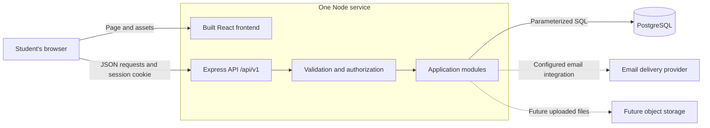
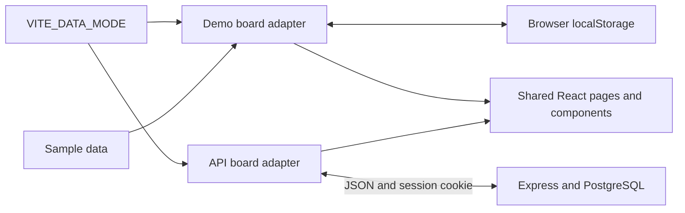
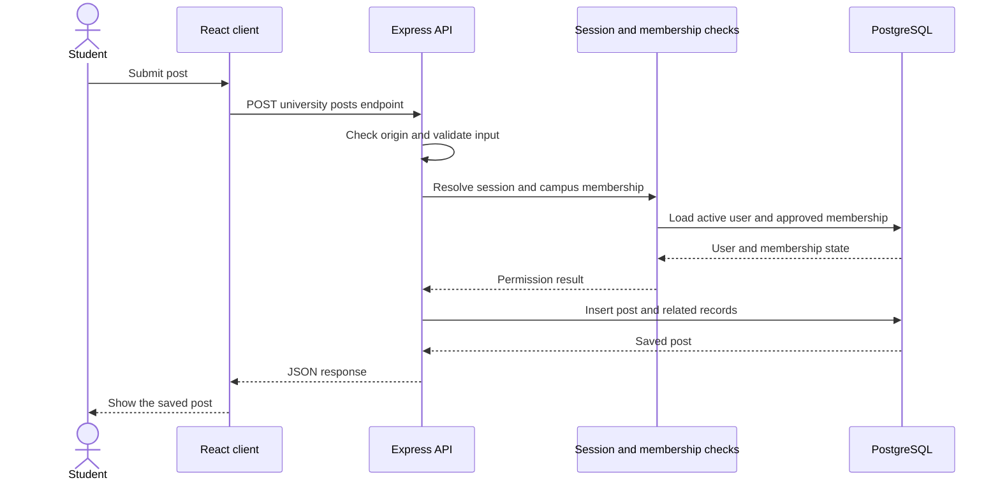
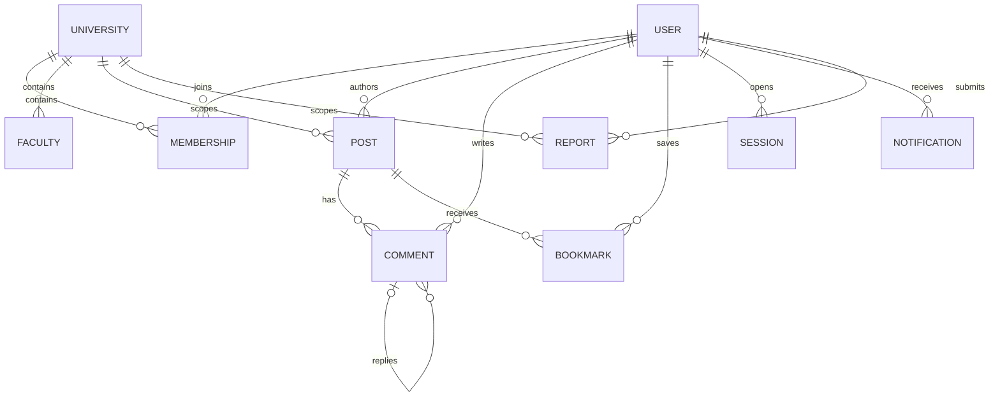

# Architecture and folder guide

UniBoard is a campus noticeboard: students find opportunities, ask questions, form groups, and organize activities inside their university. The architecture keeps that domain in one application so a small team can understand and change it.

The React frontend has two explicit data modes:

- **Demo mode**, the default, uses sample content and browser storage. Changes stay in that browser. Its preview account controls do not authenticate someone or verify student membership.
- **API mode**, selected with `VITE_DATA_MODE=api`, uses the Express application in `server/` for real sessions, membership, and shared PostgreSQL data. It has real account forms and must have a configured/migrated database. Missing API configuration is an error; it must not silently turn into demo data.

Both modes use the same pages and visual components. The storage/authentication adapter changes. A successful browser demo is not proof of an API workflow, and a connected API mode still needs production email delivery, durable uploads, and a validated operational moderation process. See [the roadmap](./product-roadmap.md) for acceptance criteria and remaining work.

## System overview

The intended production deployment uses one Node service for both the built frontend and `/api/v1`. Keeping them on the same origin simplifies cookies, deployment, and browser request rules.



The diagram describes the deployment direction. It does not mean this application has been deployed, that uploads exist, or that an email provider has been connected.

The mode boundary keeps demo data separate from real campus data:



In demo mode, browser storage belongs to an origin and a browser profile. Clearing site data removes it; opening the site on a different device does not transfer it. It is appropriate for the demonstration, and cannot provide shared posts, trustworthy roles, or real authentication. In API mode, the database owns shared records and the session cookie identifies the current account.

## Technology decisions

| Decision                                   | Reason                                                                                                 | Consequence                                                                                                                               |
| ------------------------------------------ | ------------------------------------------------------------------------------------------------------ | ----------------------------------------------------------------------------------------------------------------------------------------- |
| React 19, TypeScript, and Vite             | A clear component model, fast local feedback, and typed frontend code.                                 | Keep rendering and browser interactions in `campus/`. TypeScript helps catch mistakes but does not validate incoming network data.        |
| Tailwind CSS v4 and small component styles | A minimal visual system with reusable spacing, color, and interaction rules.                           | Prefer a small set of shared patterns over individually styled screens. Existing CSS can remain while the system is made consistent.      |
| Express 5 and TypeScript                   | A small, understandable HTTP layer that works naturally with Node.                                     | Keep route handling explicit and avoid hiding behavior in large abstractions.                                                             |
| PostgreSQL                                 | Accounts, universities, memberships, posts, and moderation have relationships and constraints.         | Use foreign keys, uniqueness rules, indexes, and transactions to protect those relationships.                                             |
| `pg` and SQL migrations                    | SQL is visible and directly reviewable; a learning project can follow what the database actually does. | An ORM is not required. Parameterize every user-controlled value and maintain database constraints deliberately.                          |
| Zod validation                             | Data from a browser, URL, or third party is untrusted at runtime.                                      | Validate at API boundaries before executing application logic.                                                                            |
| Opaque server sessions in cookies          | A random token can be revoked on the server and does not need to expose account data to the browser.   | Store only a hash of the token in the database. Keep the raw token in a secure, HttpOnly cookie.                                          |
| Node `scrypt` for passwords                | Passwords need a salted, deliberately expensive hash.                                                  | Never save or log a plaintext password; never use a fast general-purpose hash alone.                                                      |
| A modular monolith                         | One deployable app is enough for this product's initial complexity.                                    | Separate responsibilities in code before separating services. No microservices, message broker, or Redis is needed for the current scope. |
| Versioned `/api/v1` endpoints              | The HTTP contract has a clear boundary.                                                                | Change contracts deliberately and keep request/response behavior documented.                                                              |

SQL migrations are versioned changes to the database, such as creating a table or adding a unique constraint. They are application source code and should be reviewed with the feature that needs them. `pg` sends SQL to PostgreSQL; it does not design the schema or apply migrations automatically.

The database is also the session store. Redis could be introduced later for a measured requirement, but adding another service now would add configuration, failure modes, and operational work without solving a demonstrated problem.

## Request flow

For a request such as creating a post, the desired sequence is:



An invalid session, a suspended account, or an unapproved membership must stop the request before the write. The server must obtain the author from the session, rather than trusting an `authorId` sent by the client. For multi-record changes, such as saving a post and tags, use one transaction so a failure cannot leave half a result.

Frontend feedback should follow the server result. A toast saying “published” is only accurate after the server has accepted the change; a preview should explicitly describe a local save.

## Domain and data relationships

The following diagram explains the main relationships. It is a domain guide, not a replacement for the actual SQL migration files.



The central boundary is the **university membership**. An account and a university are different concepts: a user can exist before their membership is approved. Email verification proves control of an email address; approval establishes permission to participate in a particular campus. A pending manual request is not an approved membership.

Faculties belong to a university. A post's audience may be campus-wide or restricted to a faculty. Visibility, search, bookmarks, comments, notifications, and moderation must all respect the same campus and audience rules. Adding a `universityId` to a URL alone does not enforce this boundary.

## Responsibilities and folder guide

The root is an npm workspace. Install dependencies from the root so npm can manage both applications and one lockfile.

```text
UniBoard/
├── campus/                  React browser application
│   ├── src/
│   │   ├── main.tsx         Browser entry point; mounts React
│   │   ├── App.tsx          Main screen state and composition
│   │   ├── types.ts         Frontend data shapes
│   │   ├── data.ts          Sample content and prototype helpers
│   │   ├── styles.css       Shared visual styles
│   │   ├── pages/           Route-level board and collection screens
│   │   ├── features/board/  Demo/API board adapters and pure feed selectors
│   │   ├── lib/storage.ts  Safe localStorage read/write adapter
│   │   ├── lib/api.ts      HTTP client and server response types
│   │   ├── lib/api-mappers.ts Map API objects and structured post payloads
│   │   └── components/      Focused interface components and their styles
│   ├── public/              Static assets served without importing them
│   ├── index.html           HTML shell used by Vite
│   ├── vite.config.ts       React/Tailwind plugins and local API proxy
│   ├── package.json         Frontend dependencies and scripts
│   └── tsconfig.json        Frontend TypeScript settings
├── server/                  Express application and PostgreSQL setup
│   ├── src/
│   │   ├── index.ts         Process startup and environment configuration
│   │   ├── app.ts           Express setup, middleware, and router mounting
│   │   ├── db.ts            PostgreSQL pool and transaction wrapper
│   │   ├── http.ts          API errors and session/membership/role guards
│   │   ├── security.ts      Password hashing, token helpers, cookie options
│   │   ├── validation.ts    Runtime schemas for requests and post types
│   │   ├── routes/auth.ts  Register/login/verification/reset/session routes
│   │   ├── routes/campus.ts Campus content and moderation routes
│   │   └── scripts/         Explicit migration and development seed runners
│   ├── migrations/001_initial.sql Initial schema and database constraints
│   ├── test/                Security, validation, and HTTP tests
│   ├── package.json         API dependencies and scripts
│   └── .env.example         Environment variable names and safe examples
├── docs/                    Architecture, development, roadmap, deployment
├── .github/workflows/ci.yml Node build/tests with a PostgreSQL 17 service
├── render.yaml              Single-service Render blueprint; Neon configured separately
├── .prettierrc.json              Shared source/document formatting rules
├── .prettierignore          Files excluded from formatting
├── package.json             Workspace definitions and root commands
├── package-lock.json        Exact dependency resolution; commit it
├── .gitignore               Files deliberately excluded from version control
└── README.md                Project entry point and quick start
```

Some supporting paths are introduced with the backend setup. Consult the repository for the final filenames rather than creating duplicate configuration based on the illustration.

| Layer                        | What belongs here                                                                              | What should stay elsewhere                                                                        |
| ---------------------------- | ---------------------------------------------------------------------------------------------- | ------------------------------------------------------------------------------------------------- |
| React page/application state | Current filters, selected post, open dialog, loading and error state.                          | Database credentials, authoritative permissions, password handling.                               |
| React components             | Rendering, accessible controls, form fields, and callbacks.                                    | Direct database access or copies of server security rules treated as authoritative.               |
| Frontend API adapter         | HTTP requests, response mapping, and consistent network error handling in API mode.            | Modal layout or SQL. Keep requests here rather than scattering `fetch` calls across every button. |
| Express routes               | HTTP paths, parsing, status codes, and calling application logic.                              | Large business workflows embedded in route callbacks. Split them when they become hard to read.   |
| Middleware                   | Repeated request behavior: security headers, origin checks, sessions, rate limits, and errors. | Feature-specific decisions that only apply to a single action.                                    |
| Domain/application logic     | Rules such as “only the author can edit” and “closed comments reject replies.”                 | Browser presentation or assumptions that a hidden button enforces permissions.                    |
| Database access              | Parameterized SQL and small, named queries; transactions for related writes.                   | Raw request objects or string interpolation of user input.                                        |
| Migrations                   | Schema, constraints, and indexes.                                                              | Demo content that gets reinserted on every startup.                                               |
| Seed code                    | Explicit development-only sample users and content.                                            | Production startup or genuine student records.                                                    |
| Configuration                | Environment parsing and required setting checks.                                               | Secret values committed to Git.                                                                   |

The initial API can keep closely related route and domain code in the same module when it remains readable. “Modular” means clear responsibilities and interfaces; it does not require a controller, service, repository, and factory for every small endpoint.

### Important prototype files

- `campus/src/App.tsx` composes the shell and routes with React Router. It connects pages and dialogs to shared browser state.
- `campus/src/pages/BoardPage.tsx` renders the campus discovery/feed screen; `CommunityPages.tsx` contains related collection/community screens.
- `campus/src/features/board/useBoard.ts` owns demo posts, profile, saved items, notifications, and related state. `useApiBoard.ts` implements the shared operations through real requests when API mode is selected.
- `campus/src/features/board/selectors.ts` contains pure list/filter logic. Pure means the same input gives the same result without changing storage or the original array.
- `campus/src/lib/storage.ts` validates reads and catches localStorage errors. It uses versioned `uniboard:v1:` keys; this is a persistence adapter, not authentication.
- `campus/src/lib/api.ts` sends same-origin credentialed requests, handles structured errors/empty responses, and provides paged list loading. `api-mappers.ts` translates SQL-shaped responses and builds strict type-specific post requests.
- `campus/src/data.ts` contains illustrative posts, profiles, and notifications. Their claims, dates, and account badges are sample data.
- `campus/src/types.ts` describes frontend objects. API objects may have different field names or richer membership data; an adapter must map them deliberately.
- `campus/src/components/Composer.tsx` handles the local post-creation experience and type-specific fields.
- `campus/src/components/AccountDialog.tsx` handles preview profile/account/membership controls. It collects no real password and sends no verification or reset email.
- `campus/src/components/ApiAccountDialog.tsx` provides the real API-mode login/register/verify/reset, membership, and profile forms. Its development token display uses only tokens actually returned by the backend.
- `Avatar`, `Sidebar`, `PostCard`, and `CampusAside` provide reusable presentation. `PostDetail` owns the post discussion interaction, and `ReportDialog` collects a report through the selected mode's handler.
- `campus/src/pages/LiveModerationPage.tsx` loads real report/membership queues and the audit trail; authorized reviewers provide a reason when resolving reports, removing content, deciding memberships, or suspending reported members.
- `campus/src/components/account.css` and `dialogs.css` contain styles for those dialogs.

## Security boundaries

Authorization is a server responsibility. The backend must check all of the following as appropriate, even when the frontend already hides a control:

1. The session exists, is unexpired, and belongs to an active account.
2. The user has an approved membership in the university addressed by the request.
3. The resource actually belongs to that university.
4. The audience permits the member to see the resource.
5. An edit/delete action belongs to the author, or an allowed moderator action is being used.
6. A moderator's role applies to that university. A role from one campus must not grant access to another campus.

Use an explicit trusted origin for browser writes. Cookie-based authentication requires protection against cross-site requests; a cookie's `SameSite` setting is one layer, and server origin checks remain part of the design. Use HTTPS and secure cookies in production. Do not put session tokens in localStorage, URLs, analytics events, or application logs.

Passwords use salted `scrypt` hashes. Session and one-time email/reset tokens use cryptographically random values; store their hashes, scope their purpose, set an expiry, and consume one-time tokens once. Password resets must invalidate relevant sessions according to the backend policy. Development token shortcuts must never be enabled in production.

Post bodies are student-provided content. Render them as text or through an explicitly sanitized formatting pipeline. Validate links and file metadata; do not render arbitrary HTML. Uploaded files need a separate storage and access policy before real uploads are enabled.

## Selecting a mode and extending the API integration

Set `VITE_DATA_MODE=demo` or `VITE_DATA_MODE=api` in the frontend environment, following `campus/.env.example`. Vite reads this setting at startup/build time. Restart the dev server after changing it; rebuild before deploying a different mode. Setting a server variable after assets have been built cannot change code already shipped to browsers.

API mode connects session/membership loading, live account forms, the feed, post mutations, comments, saved posts, profiles, polls, and notifications to the server. Request mapping translates the UI's human-readable strings into the backend's structured schema. It does not make arbitrary demo objects valid API payloads.

The initial client loads **the first 100 posts plus the student's saved posts** and filters that loaded set in the browser. It shows a limit notice when the feed exceeds 100. A search can therefore miss an older, unsaved matching post outside that page; the backend supports paginated/search queries, but full client feed pagination and server-driven searching remain work. Other lists use the paged list helper, with an explicit upper bound of 10,000 records rather than an unannounced first-page cutoff.

Keep new API workflows within the adapter boundary: add a request, map its response, expose a clear loading/error state, then connect the UI. Do not fall back to a locally saved success when the server rejects the action. Likes and accepted-answer actions have no real API support and are unavailable in API mode. The live moderation page handles the current review actions; durable uploads and full club-officer/administrator interfaces remain future work.

The frontend must never manufacture an approved membership when the server says approval is pending. Keep demo mode visibly identified and use separate browser profiles to verify shared data and account isolation in API mode.

## API contract and integration differences

The implementation sources are [account routes](../server/src/routes/auth.ts), [campus routes](../server/src/routes/campus.ts), [runtime validation](../server/src/validation.ts), and [database schema](../server/migrations/001_initial.sql). These define exact request bodies, supported endpoints, and constraints. The [API guide](./api.md) provides runnable PowerShell workflows and a field reference. Check the contract instead of inferring it from the browser demo.

### Route map

All paths below are relative to `/api/v1`. In this table, `:u` means the university UUID and `:p` means the post UUID. These abbreviations explain the map; the source uses descriptive parameter names.

| Method and route                                                                | Purpose and access                                                                                                                             |
| ------------------------------------------------------------------------------- | ---------------------------------------------------------------------------------------------------------------------------------------------- |
| `GET /health`, `/health/ready`                                                  | Check process/configuration and database connectivity respectively. Readiness runs `SELECT 1`; it does not validate the schema.                |
| `POST /auth/register`, `/auth/login`, `/auth/logout`                            | Create an account, start a server session, or invalidate the current session. Registration and login have their own validation/security rules. |
| `GET /auth/me`                                                                  | Read the current authenticated account and its memberships.                                                                                    |
| `POST /auth/verify-email`, `/auth/resend-verification`                          | Consume an email-verification token or request another verification email.                                                                     |
| `POST /auth/forgot-password`, `/auth/reset-password`                            | Request a reset and consume a one-time reset token. A completed reset invalidates the user's sessions.                                         |
| `GET /universities`, `/universities/:u/faculties`                               | List public campus/faculty reference data. A configured database is still required.                                                            |
| `GET`, `PATCH /profile`                                                         | Read/update the signed-in student's profile fields.                                                                                            |
| `GET /notifications`, `PATCH /notifications/:notificationId`                    | Read/update the account's own notifications, including membership/moderation decisions when campus access is pending or suspended.             |
| `GET`, `POST /universities/:u/membership`                                       | Read or request the user's membership. Account email must be verified before requesting membership.                                            |
| `POST /universities/:u/membership/verify`                                       | Consume a campus-email verification token for the signed-in student.                                                                           |
| `GET`, `POST /universities/:u/posts`                                            | Browse/search or create campus posts; approved membership required.                                                                            |
| `GET`, `PUT`, `DELETE /universities/:u/posts/:p`                                | Read or update/remove a post. Regular edits/removal require authorship.                                                                        |
| `PATCH /universities/:u/posts/:p/comments-status`                               | Let the post author open/close comments.                                                                                                       |
| `GET`, `POST /universities/:u/posts/:p/comments`                                | Read a thread or add a comment/reply to an accessible post.                                                                                    |
| `PATCH`, `DELETE /universities/:u/comments/:commentId`                          | Edit/remove the student's own comment.                                                                                                         |
| `POST /universities/:u/posts/:p/vote`, `GET .../votes`                          | Submit or inspect poll votes, subject to the poll's state.                                                                                     |
| `GET /universities/:u/bookmarks`, `PUT`, `DELETE .../bookmarks/:p`              | Read or change the current student's saved posts.                                                                                              |
| `GET /universities/:u/notifications`, `PATCH .../notifications/:notificationId` | Read the student's notifications and update read state.                                                                                        |
| `GET /universities/:u/clubs`                                                    | List campus club reference data.                                                                                                               |
| `POST /universities/:u/reports`                                                 | Report a campus post, comment, or user.                                                                                                        |
| `/universities/:u/moderation/*`                                                 | Moderator/admin operations for reports, membership review, campus suspensions, content removal, and the audit log.                             |

Except for the public reference routes and account entry flows, requests need a session. Campus content routes also require an approved membership, and moderation routes require a campus moderator/admin role. Account-level notifications remain accessible so a rejected or suspended student can read their decision. A suspension in the current model blocks that university membership; it is not a global deletion of the account.

Responses normally use `{ "data": ... }`, with `meta` for paginated collections. Errors use `{ "error": { "code": "...", "message": "..." } }`, sometimes with validation details. Successful deletes/logout can return `204` with no JSON body, so an API client must not unconditionally parse every successful response as JSON.

Feed queries support `q`, `type`, `facultyId`, `tag`, `from`, `to`, `mine`, `page`, and `limit`. The backend orders strictly newest first, with an ID tie-breaker. Date values use ISO datetimes with an offset. Check `validation.ts` for field limits and the exact type-specific payload.

In explicit development mode, the account API may return a `developmentToken` to exercise email verification/reset without real email. Production must use configured delivery and must never return this shortcut. This behavior belongs to the backend development API; it does not turn the preview account dialog into a real email flow.

Important differences already visible in the two models:

| Prototype                                                                          | Real API foundation                                                                                                            | Integration work                                                                                                      |
| ---------------------------------------------------------------------------------- | ------------------------------------------------------------------------------------------------------------------------------ | --------------------------------------------------------------------------------------------------------------------- |
| A single `Profile` object includes campus, faculty, and a preview `verified` flag. | Account data and university memberships are separate records. Account email verification is distinct from membership approval. | Map session and membership states explicitly; remove trust in a browser flag.                                         |
| Sample IDs and names identify posts and faculties.                                 | API resources use UUIDs and database relationships.                                                                            | Load real university/faculty IDs and preserve them in requests.                                                       |
| Post details use human-readable labels and strings.                                | Zod validates structured, type-specific detail keys and values.                                                                | Build request payloads per post type; do not send the preview object unchanged.                                       |
| A profile photo can be previewed from a safe HTTP/HTTPS URL.                       | API profile/image inputs require HTTPS URLs.                                                                                   | Apply the stricter API validation in live forms. Durable upload handling is separate work.                            |
| Profile email can be edited locally.                                               | The profile endpoint updates profile fields, not the account email.                                                            | Keep account email read-only in live profile editing until a verified email-change workflow exists.                   |
| A local sign-in state needs no password.                                           | API mode uses real account forms, `scrypt` password checks, and a cookie session.                                              | Production email must be connected for verification/recovery; explicit development tokens are a development aid only. |
| Sample comments identify people by display information.                            | Database comments carry author IDs and enforce ownership.                                                                      | Use server IDs for permission decisions, never display names.                                                         |

The backend has been exercised against a dedicated real PostgreSQL database, including isolation/ownership and authentication vertical slices. This is stronger evidence than mocked queries, and does not replace browser workflow tests, provider email delivery tests, or a deployment check. Routine `npm test` skips the PostgreSQL suite unless `TEST_DATABASE_URL` is configured.

See [development practices](./development.md), [MVP scope](./product-roadmap.md), and [deployment](./deployment.md).
